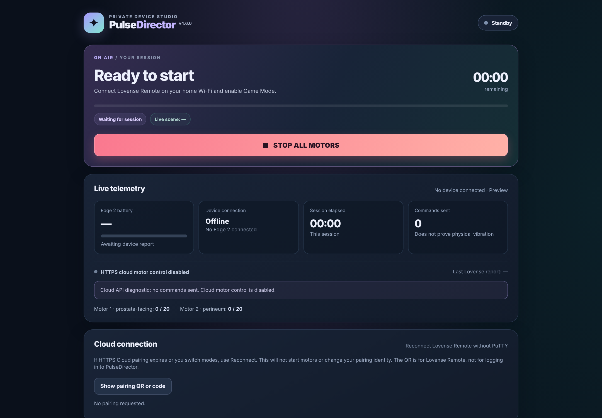
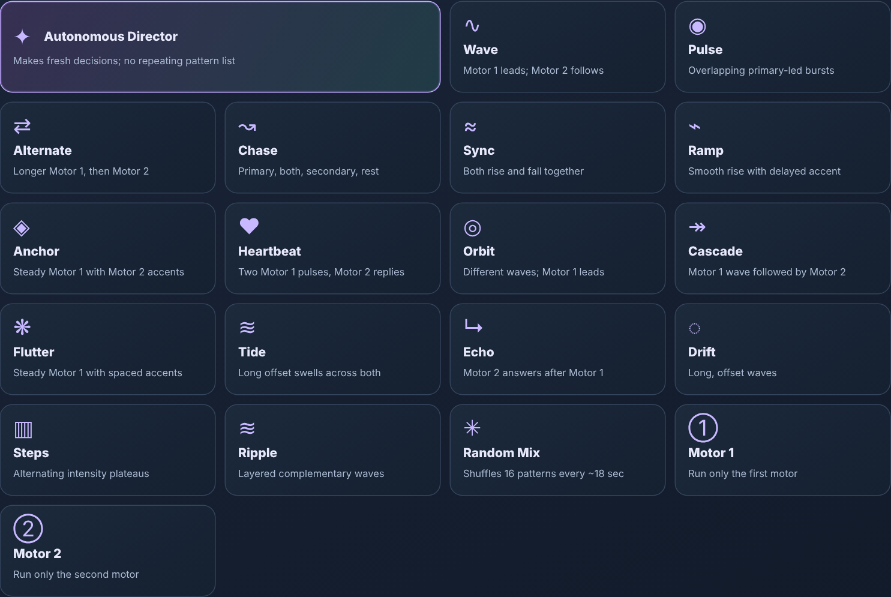
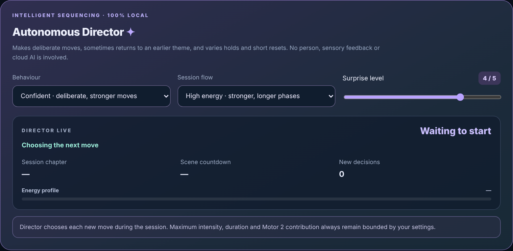
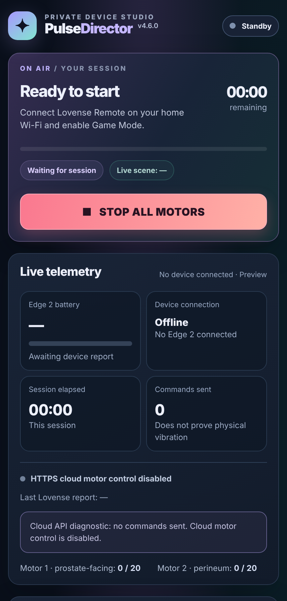
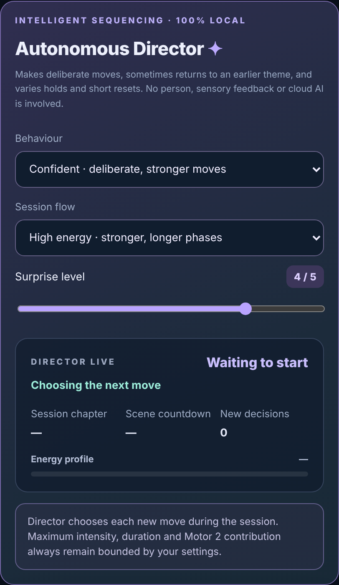

# PulseDirector v4.6 — Edge 2 LAN & Hybrid controller

**Experimental / community project — not a certified physical safety device.** An independent, free, self-hosted browser controller for **one Lovense Edge 2** on Linux / Raspberry Pi OS, with a local Game Mode (LAN) profile and an **optional experimental** HTTPS Cloud integration. It is not affiliated with Lovense.

[](https://github.com/Otautahi/pulse-director/actions/workflows/tests.yml) · [MIT source licence](LICENSE) · [Security and limitations](docs/SECURITY.md)

## Where can I run it?

| What you have | Installation status |
|---|---|
| **Raspberry Pi 3B+** running Raspberry Pi OS / Linux with Python 3.10+ | **Owner-tested** with one Edge 2 |
| **Other Raspberry Pi models** with a suitable Linux OS and Python 3.10+ | Intended to work; not individually hardware-tested |
| **Linux PC, mini PC or server** with Python 3.10+ | Supported source setup; physical Edge 2 testing has focused on the Pi |
| **Windows or macOS computer** | Native installation **not verified or documented** |
| **Android or iPhone alone** | **Not a standalone phone app.** The phone runs Lovense Remote; open the PulseDirector dashboard in a browser |

**You also need:** one Lovense **Edge 2**, a phone running Lovense Remote with **Game Mode**, and a trusted local network connecting the phone and Linux host. **Max 2 and multiple toys aren't supported yet.** No paid cloud service or Python `pip` packages are required for the standard LAN setup.

**New to this? Follow the [step-by-step installation guide](docs/INSTALL.md)** — it covers requirements, which IP address to use, opening the dashboard, first off-body test, and troubleshooting.

## Screenshots — v4.6 web dashboard

These are **static previews rendered from the actual v4.6 interface**, with the Edge 2 disconnected and no session active. No pairing codes, access keys, or private network details are shown.

### Desktop dashboard



### Pattern library and Autonomous Director





<details>
<summary>Mobile dashboard previews</summary>

<p>
  
  
</p>
</details>

## Profiles — LAN is the default

| | LAN (default) | Hybrid (opt-in) |
|---|---|---|
| Phone Game Mode over trusted LAN | Yes | Preferred when available |
| Lovense HTTPS API motor commands | **No** | Experimental, **disabled by default** |
| Cloud pairing / QR controls | Hidden/blocked | Available only with separate configuration |
| Personal cloud token required | No | Only when configuring cloud transport |
| Cloud response proves physical Stop | No | **No** |

- Start in LAN mode with `--profile lan` (or omit `--profile`); no cloud token is loaded, and the cloud pairing API is unavailable.
- `--profile hybrid` selects a LAN-first controller with cloud diagnostic/pairing functionality. It does **not** authorize cloud motor commands. Cloud use additionally requires separately configured credentials, verified pairing and an owner-controlled enable flag. Runtime flag removal revokes new cloud motor commands; Stop remains permitted, and re-enabling requires a fresh process.
- Both profiles share the motor-pattern engine and rule-based **Autonomous Director** (20 modes, manual independent motor controls, adjustable intensity, session timers, and Stop/recovery safeguards).

**Supported device:** a *single* reported Edge 2. Max 2, other toys and simultaneous multi-device operation are **not implemented**. The program refuses ambiguous, unsupported or multiple reported devices.

## Quick start — Raspberry Pi OS / Linux

**1. Install Git and check Python.** On Raspberry Pi OS, Debian or Ubuntu:

```bash
sudo apt update
sudo apt install -y git python3
python3 --version
```

If the version is lower than **3.10**, use a supported newer Linux OS image before continuing.

**2. Download and run the offline tests** (no device commands):

```bash
git clone https://github.com/Otautahi/pulse-director.git
cd pulse-director
python3 -m unittest discover -s tests -q
```

**3. Connect one off-body Edge 2 in Lovense Remote**, enable Game Mode, and find the phone's local Wi-Fi IP address. On the Linux computer run `hostname -I` to find its **trusted LAN IP**. The phone and computer must be able to reach each other.

**4. Start PulseDirector** — replace `PHONE_IP` and `LINUX_IP` with the two real IP addresses:

```bash
python3 edge_dashboard.py --profile lan --phone PHONE_IP --bind LINUX_IP --port 8765
```

**5. Open** `http://LINUX_IP:8765` in a browser on your trusted network. The dashboard access key is shown in the Linux terminal. Keep it private. Start with the Edge 2 **off-body at the lowest intensity** and check manual and timed Stop.

To stop the server, press **Ctrl+C** in the terminal. No background service or automatic startup is installed by these steps. For a no-device preview, remote/headless Pi access, additional troubleshooting and safe update guidance, see the **[full installation guide](docs/INSTALL.md)**.

**Important:** This is an experimental controller, not a hardware fail-safe. A phone, Wi-Fi or Bluetooth outage can prevent a Stop reaching the toy. Keep its physical power button accessible. **Never port-forward the HTTP dashboard to the internet.**

## Safety limitations

**The controller cannot guarantee physical Stop during loss of Bluetooth, Wi-Fi, phone connectivity or cloud access.** A successful API response does not verify motor state. An earlier off-body LAN test observed *brief renewed vibration on Bluetooth reconnection* before recovery Stop. After recovery changes, the owner retested Bluetooth disconnect/reconnect in simulation and with the Edge 2 off-body; **the unintended vibration was not observed again in those tests**. This supports the software regression fix, but it does not prove physical Stop under every failure condition. Keep the physical power button reachable and power off if behavior is unexpected.

LAN/Hybrid sessions pin the transport used to start a session; a failure latches a fault and blocks auto-resume. Cloud Stop requires separate physical-off acknowledgment before another Start; cloud callbacks indicate past pairing, not live device heartbeat. Testing was performed with simulated faults and limited owner-observed off-body tests on one Edge 2, **not** independently certified across devices or firmware.

## Install, help and history

- [Installation and startup](docs/INSTALL.md) · [Security and deployment](docs/SECURITY.md) · [Hybrid mode explained and safe preview](docs/HYBRID.md)
- [Troubleshooting](docs/TROUBLESHOOTING.md) · [Release checklist](docs/RELEASE_CHECKLIST.md) · [Changelog](CHANGELOG.md)
- The original **v4.5 LAN-only edition** is preserved in the [`release/v4.5.0-lan-rc1` branch](https://github.com/Otautahi/pulse-director/tree/release/v4.5.0-lan-rc1). The legacy branch and Git history are retained; this v4.6 tree is the unified current codebase.

The MIT licence covers this project's own source. Lovense API/developer terms and trademark rights are separate; see the [licensing caveat](docs/SECURITY.md) and [issue #4](https://github.com/Otautahi/pulse-director/issues/4). This source release does not imply vendor endorsement or permission beyond those terms.
